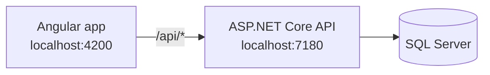
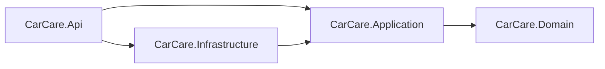

# CarCare


**CarCare** is a full-stack web application for managing personal vehicles, tracking their maintenance
history and keeping an eye on car-related expenses and upcoming service work.

It is a portfolio project built with **ASP.NET Core Web API**, **Angular** and **Microsoft SQL Server**.
The focus is on clean architecture, maintainable code and realistic business logic rather than on
building a large platform.

## Table of contents

- [Features](#features)
- [Tech stack](#tech-stack)
- [Architecture](#architecture)
- [Project structure](#project-structure)
- [Getting started](#getting-started)
- [Configuration](#configuration)
- [Database migrations](#database-migrations)
- [Design decisions](#design-decisions)

## Features

The project is developed incrementally, one module at a time.

- [x] Project architecture, local development setup and API documentation
- [ ] **Vehicles** – add, view, edit and delete vehicles (make, model, year, license plate, mileage)
- [ ] **Maintenance history** – services, repairs and other work with date, mileage, description and cost
- [ ] **Maintenance reminders** – upcoming work based on date and, where it makes sense, mileage
- [ ] **Expenses** – categorized vehicle expenses and spending totals
- [ ] **Dashboard** – overview of vehicles, recent services, upcoming reminders and costs
- [ ] Authentication and per-user data *(planned for a later phase)*

## Tech stack

| Area      | Technologies                                                          |
| --------- | --------------------------------------------------------------------- |
| Backend   | C#, ASP.NET Core Web API (.NET 9), Entity Framework Core 9            |
| Database  | Microsoft SQL Server (SQL Server LocalDB for local development)       |
| API docs  | OpenAPI (`Microsoft.AspNetCore.OpenApi`) with Swagger UI              |
| Frontend  | Angular 21, TypeScript, Angular Router, HttpClient, Signals, SCSS     |
| Testing   | Vitest (frontend)                                                     |
| Tooling   | Git, npm, `dotnet-ef` (pinned as a local .NET tool)                   |

## Architecture

### Overview

The Angular app talks to the backend over a REST API. In development, the Angular dev server proxies
every `/api` request to the backend, so no CORS configuration is needed.



### Backend – layered architecture

The backend is split into four projects. Dependencies always point inward, toward the domain.



| Project                  | Responsibility                                                                  |
| ------------------------ | ------------------------------------------------------------------------------- |
| `CarCare.Domain`         | Entities and business rules. No dependencies on other projects or frameworks.   |
| `CarCare.Application`    | Use cases, application services, DTOs and abstractions (e.g. data access interfaces). |
| `CarCare.Infrastructure` | EF Core `DbContext`, SQL Server setup and implementations of application abstractions. |
| `CarCare.Api`            | HTTP endpoints, configuration and dependency injection (composition root).      |

Each layer registers its own services through an extension method, so `Program.cs` stays small:

```csharp
builder.Services
    .AddApplication()
    .AddInfrastructure(builder.Configuration);
```

### Frontend – feature-oriented structure

| Folder      | Purpose                                                                          |
| ----------- | -------------------------------------------------------------------------------- |
| `core/`     | App-wide singletons: layout (header, navigation), services, later interceptors and guards. |
| `shared/`   | Reusable presentational components, directives and pipes.                         |
| `features/` | One folder per feature (components, services, models, routes), lazy-loaded by the router. |

The app uses standalone components, signals and `OnPush` change detection.

## Project structure

```
CarCare/
├── CarCare.sln
├── global.json                     # pins the .NET SDK (9.0.x)
├── Directory.Build.props           # shared build settings for all .NET projects
├── .config/dotnet-tools.json       # local .NET tools (dotnet-ef)
├── backend/
│   └── src/
│       ├── CarCare.Domain/
│       ├── CarCare.Application/
│       ├── CarCare.Infrastructure/
│       │   └── Persistence/        # CarCareDbContext, entity configurations, migrations
│       └── CarCare.Api/
└── frontend/
    ├── proxy.conf.json             # dev proxy: /api -> backend
    └── src/
        ├── environments/
        └── app/
            ├── core/
            ├── shared/
            └── features/
```

## Getting started

### Prerequisites

- [.NET SDK 9.0](https://dotnet.microsoft.com/download/dotnet/9.0)
- [Node.js](https://nodejs.org/) 20.19+ or 22.12+ (with npm)
- SQL Server LocalDB (included with Visual Studio or SQL Server Express) or any other SQL Server instance
- A trusted HTTPS development certificate:

  ```bash
  dotnet dev-certs https --trust
  ```

A global Angular CLI installation is not required.

### 1. Clone the repository

```bash
git clone <repository-url>
cd CarCare
```

### 2. Run the backend

```bash
dotnet tool restore
dotnet run --project backend/src/CarCare.Api --launch-profile https
```

| URL                                      | Description          |
| ---------------------------------------- | -------------------- |
| https://localhost:7180/swagger           | Swagger UI           |
| https://localhost:7180/openapi/v1.json   | OpenAPI document     |
| https://localhost:7180/api/health        | Health check         |

Swagger UI and the OpenAPI document are only available in the `Development` environment.

### 3. Run the frontend

In a second terminal:

```bash
cd frontend
npm install
npm start
```

Open http://localhost:4200. The home page shows whether the API is reachable.

### Build and test

```bash
# backend (from the repository root)
dotnet build

# frontend
cd frontend
npm run build
npm test -- --watch=false
```

## Configuration

The API reads its database connection string from `ConnectionStrings:CarCare`.

| Environment            | Source                                                                                  |
| ---------------------- | --------------------------------------------------------------------------------------- |
| Development (default)  | `appsettings.Development.json` – LocalDB with Windows authentication, no credentials stored |
| Custom local SQL Server | [User Secrets](https://learn.microsoft.com/aspnet/core/security/app-secrets) (see below) |
| Other environments     | Environment variable `ConnectionStrings__CarCare`                                        |

To use a different SQL Server instance locally without committing credentials:

```bash
dotnet user-secrets set "ConnectionStrings:CarCare" "Server=...;Database=CarCare;User Id=...;Password=...;TrustServerCertificate=True" --project backend/src/CarCare.Api
```

If no connection string is configured, the API fails at startup with a clear error message.

## Database migrations

`CarCareDbContext` lives in `CarCare.Infrastructure/Persistence` and automatically applies every
`IEntityTypeConfiguration<T>` from the Infrastructure assembly.

```bash
# create a migration
dotnet ef migrations add <MigrationName> \
  --project backend/src/CarCare.Infrastructure \
  --startup-project backend/src/CarCare.Api \
  --output-dir Persistence/Migrations

# apply migrations to the database
dotnet ef database update \
  --project backend/src/CarCare.Infrastructure \
  --startup-project backend/src/CarCare.Api
```

## Design decisions

- **Layered architecture with inward dependencies.** The domain stays free of framework code, and the
  application layer depends only on abstractions, which keeps business logic easy to test.
- **The API project is the composition root.** It is the only project that knows about every layer and
  wires them together through dependency injection.
- **No unnecessary patterns.** Generic repositories, CQRS, MediatR and microservices are intentionally left
  out. They will be introduced only if a concrete need appears.
- **Feature-oriented frontend.** Each feature is self-contained and lazy-loaded, so the app can grow
  without a single shared components folder.
- **Dev proxy instead of CORS.** The frontend calls relative `/api` URLs, so the same code works locally and
  behind a reverse proxy in production.
- **No secrets in the repository.** Local development uses Windows authentication; any credentials go to
  User Secrets or environment variables.
